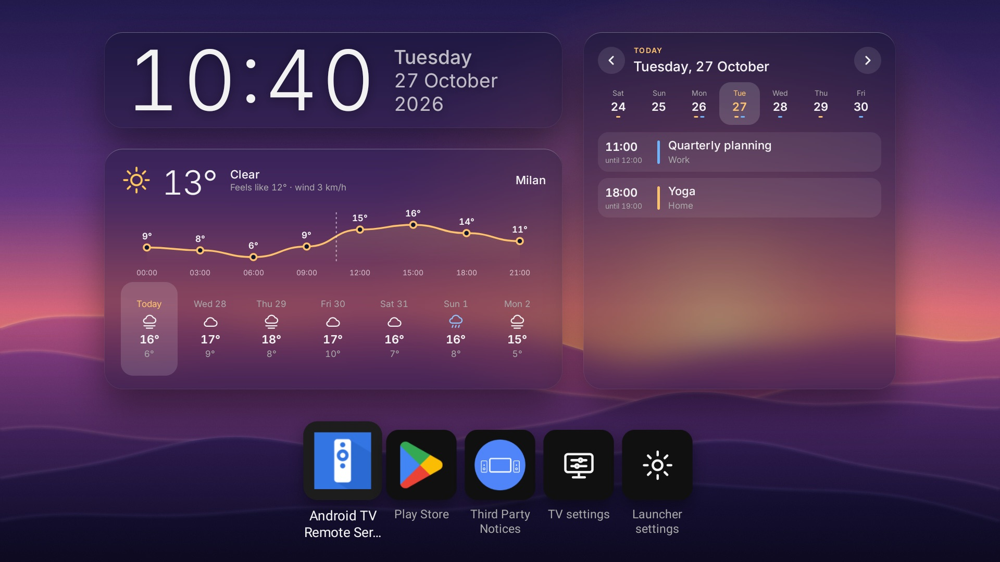
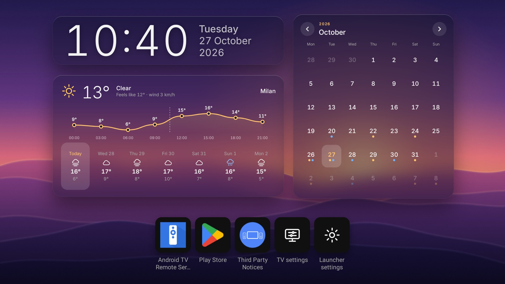
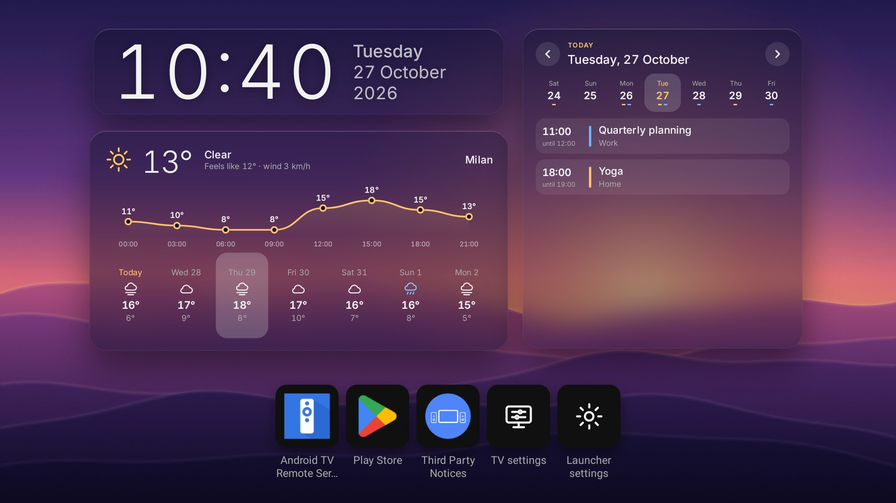
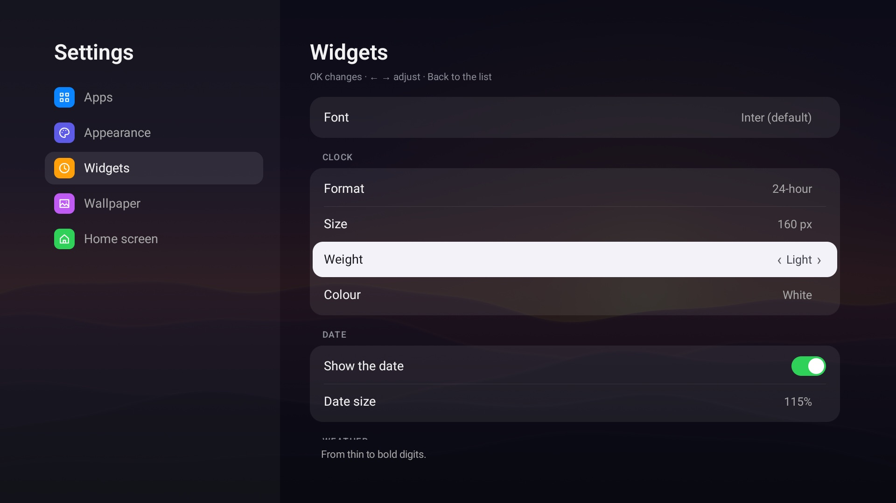
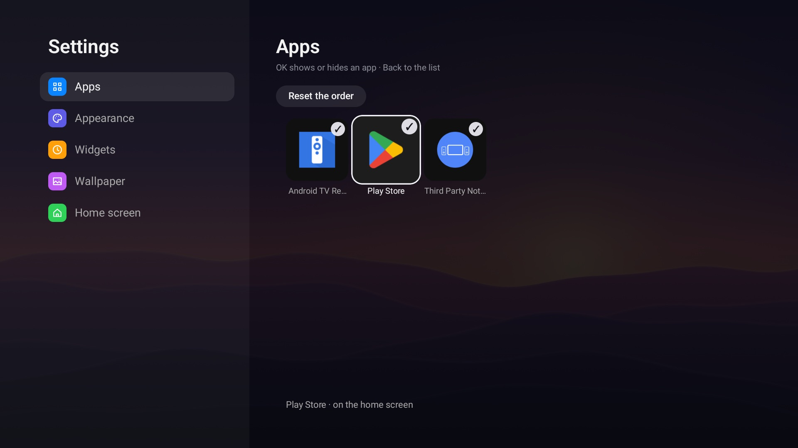

<p align="center"></p>

# Simple TV launcher

A quieter home screen for Android TV and Google TV boxes. You get a clock, the weather, your day from Google Calendar and one row of apps, laid over a wallpaper. No ads, no rows of recommendations, nothing that autoplays.

This is the Android TV version of [Simple LG launcher](https://github.com/fardroid/Simple-LG-launcher), which I wrote for my LG TV as a fork of [Hearth](https://github.com/rudra-avatar/Hearth) by rudra-avatar. It looks and works the same, but it is a native Android app in Kotlin and Jetpack Compose, not a web page in a wrapper. It needs no root and asks for no permissions beyond the internet.

> **The easy way to install it:** give the link to this repository to Claude Code or Codex and ask it to set the launcher up on your box. [AGENTS.md](AGENTS.md) walks the agent through every step: building, installing, making it the home screen and adding your calendars. It checks with you before it changes anything on the box. You only need the box's IP address and network debugging switched on.



| | |
|---|---|
|  |  |
|  |  |

## What's on the screen

- **Clock and date.** A large clock with the weekday and date next to it. Six typefaces, five weights from thin to bold, any size, 12- or 24-hour. The font you pick is used by the weather and calendar cards too.
- **Weather** from [Open-Meteo](https://open-meteo.com), no account needed: the temperature now, what it feels like, the wind, an hourly curve for the day and seven days ahead. Press ↑ from the app row to step onto it, then ← → move through the days and the curve redraws for each one.
- **Calendar.** Add the secret iCal address of a Google Calendar (or any `.ics` link). You can add several, and each gets its own colour. Repeating events, exceptions, moved events and all-day events all work. Step onto it with ↑, use ← → to go through the days, and ↑ once more opens the whole month with a dot under each busy day.
- **Frosted glass.** The cards blur the wallpaper behind them. They turn light or dark together, depending on how bright the picture is behind them, so the text stays readable on any picture.
- **Your apps in one row.** Hold OK on a tile to move it, hide it, open its app info or uninstall it. At the end of the row are two tiles of the launcher's own: the box's settings and the launcher's settings.
- **Wallpapers.** Thirteen come built in (soft gradients, dunes, auroras, a sea at dawn), shown as a slideshow with shuffle and an interval from 10 seconds to an hour. You can add your own pictures too.
- **English or Russian.** It follows the box's language by default. Settings → Home screen → Language changes it.

## What you need

- An Android TV or Google TV box with Android 9 or newer.
- A computer on the same network with `adb` ([Android SDK Platform Tools](https://developer.android.com/tools/releases/platform-tools)), and JDK 17 or newer to build the app.
- Network debugging switched on on the box: Settings → System → About → press *Android TV OS build* seven times, then Settings → System → Developer options → *USB debugging* (on most boxes this also covers debugging over the network). The menu names differ a little between boxes.

I use it on a Xiaomi Mi TV Stick 4K (Android 11, with the Google TV home screen). It is also tried on the Android TV emulator.

## Installing it yourself

```bash
git clone https://github.com/fardroid/AndroidTV_Simple_Launcher.git
cd AndroidTV_Simple_Launcher
./gradlew assembleDebug                     # makes app/build/outputs/apk/debug/app-debug.apk
adb connect <box-ip>:5555                   # the box asks once whether to allow this computer
adb install -r app/build/outputs/apk/debug/app-debug.apk
```

The launcher then shows up among the apps as *Simple TV launcher*. Updating is the same `install -r`, and your settings stay.

## Making it the home screen

**1. Choose it as the home app.** On the box: Settings → Apps → *Default home screen* (the name differs between boxes) → *Simple TV launcher*. Settings → Home screen → *Launcher by default* in the launcher opens that screen for you. On plain Android TV this is all it takes.

**2. On Google TV, also switch on the Home button helper.** Google TV sends the Home button to its own home screen whichever home app you choose. So the launcher comes with a small accessibility service: when the Home button is pressed, or the Google TV home screen comes up anyway, it opens the launcher. Switch it on in Settings → Accessibility → *Simple TV launcher*. It reads nothing on the screen and sends nothing anywhere. Android switches it off again whenever the launcher is updated, so turn it back on after an update. *Launcher by default* in the launcher's settings says *Yes* only when the Home button really opens the launcher, and OK on it opens whichever of the two screens still needs a change.

**Switching the stock home screen off instead.** You can also turn the Google TV home screen off from the computer:

```bash
adb shell pm disable-user --user 0 com.google.android.apps.tv.launcherx    # undo: pm enable
```

I don't recommend it. On my Xiaomi stick Google TV then opened its set-up wizard (`com.google.android.tungsten.setupwraith`) in place of the home screen and left a black screen, so I switched the stock home screen back on. If you try it anyway, keep the `pm enable` line at hand.

## Calendars

In Google Calendar on a computer, open Settings, choose the calendar, and copy **Secret address in iCal format**. Then, in the launcher: Settings → Widgets → Calendars → *Add a link…*.

Typing a long link with the remote is no fun, so you can hand the links over from the computer instead (separate several with commas):

```bash
adb shell am start -n tld.my.hearth/.MainActivity --esa calendars "https://…/basic.ics,https://…/basic.ics"
```

The secret address gives read access to that calendar to anyone who has it. It is only kept on the box and only sent to Google. Don't commit it anywhere.

## Wallpapers

The thirteen built-in pictures are in [`app/src/main/assets/wallpapers`](app/src/main/assets/wallpapers): drawn for this launcher and free to use. To add your own, copy them to the launcher's folder on the box. They show up the next time the launcher comes to the front:

```bash
adb push my-picture.jpg /sdcard/Android/data/tld.my.hearth/files/wallpapers/
```

JPG, PNG or WebP. 1920×1080 or larger looks best; bigger pictures are scaled down when they are loaded.

## Privacy

For the weather the launcher sends the coordinates of your city to Open-Meteo, plus whatever you type into the city search. The calendar links are fetched by the box directly. Nothing else leaves the box, and there is no tracking of any kind.

## Working on it

```bash
./gradlew assembleDebug
./gradlew testDebugUnitTest
```

Kotlin and Jetpack Compose in one activity; besides AndroidX and Kotlin coroutines it uses no libraries. Everything is laid out on a 1920×1080 design screen, the same as the webOS version. Comments like "a port of `src/lib/plates.ts`" point to the matching file in [Simple LG launcher](https://github.com/fardroid/Simple-LG-launcher), where the same feature first appeared. [CHANGELOG.md](CHANGELOG.md) has the history.

The app ID is `tld.my.hearth`, which is left over from the time the port lived next to the webOS code. It stays as it is, so updates install over the copies already on people's boxes.

## Credits

- [Hearth](https://github.com/rudra-avatar/Hearth) by rudra-avatar, which the webOS version started as a fork of. Its look and most of its ideas carried over here.
- [Simple LG launcher](https://github.com/fardroid/Simple-LG-launcher), the webOS version.
- [Open-Meteo](https://open-meteo.com) for the free weather.

Fonts and other bundled material are listed in [THIRD_PARTY_NOTICES.md](THIRD_PARTY_NOTICES.md). MIT licence, see [LICENSE](LICENSE). Not affiliated with Google; "Android TV" and "Google TV" are their trademarks.
